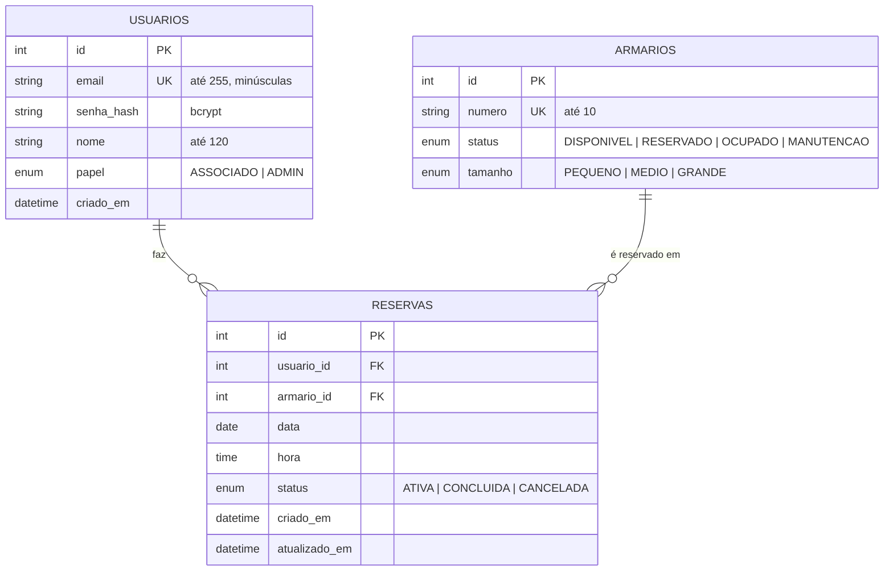

# Diagrama de Entidade-Relacionamento (DER) - Locky

> **Revisado na N2.** A versão da N1 descrevia colunas e valores que não existiam no
> código (`data_inicio`, `data_fim`, `localizacao`, papel `ALUNO`, status `EXPIRADA`).
> Este documento foi refeito a partir de `backend/app/models/` e das migrations em
> `backend/alembic/versions/`, que são a fonte da verdade do esquema.

## 1. Visão Geral

O modelo tem três entidades: **Usuário**, **Armário** e **Reserva**. Um usuário possui
várias reservas ao longo do tempo; um armário aparece em várias reservas ao longo do
tempo. A N2 **não alterou o esquema** (nenhuma migration nova): as evoluções usam as
tabelas existentes.

## 2. Diagrama



## 3. Dicionário de Dados

Os enums são gravados no PostgreSQL como tipos `ENUM` com o **nome** do membro
(`ATIVA`, `DISPONIVEL`...). A API expõe valores em inglês minúsculo
(`active`, `available`...); a tradução fica em `backend/app/schemas/`.

### 3.1. `usuarios`

| Coluna | Tipo | Restrições | Descrição |
| :--- | :--- | :--- | :--- |
| `id` | Integer | PK | Identificador. |
| `email` | String(255) | Not Null, Unique, Index | Login. Normalizado para minúsculas no cadastro e no login (N2). |
| `senha_hash` | String(255) | Not Null | Hash bcrypt. A senha em texto nunca é gravada. |
| `nome` | String(120) | Not Null | Nome exibido. |
| `papel` | Enum `papelusuario` | Not Null, default `ASSOCIADO` | `ASSOCIADO` (cliente da academia) ou `ADMIN`. |
| `criado_em` | DateTime | Not Null, default `now()` | Data de cadastro. |

### 3.2. `armarios`

| Coluna | Tipo | Restrições | Descrição |
| :--- | :--- | :--- | :--- |
| `id` | Integer | PK | Identificador. |
| `numero` | String(10) | Not Null, Unique, Index | Número visível no armário (ex.: `01`). |
| `status` | Enum `statusarmario` | Not Null, default `DISPONIVEL` | Ver ciclo de vida abaixo. |
| `tamanho` | Enum `tamanhoarmario` | Not Null | `PEQUENO`, `MEDIO` ou `GRANDE`. |

### 3.3. `reservas`

| Coluna | Tipo | Restrições | Descrição |
| :--- | :--- | :--- | :--- |
| `id` | Integer | PK | Identificador. |
| `usuario_id` | Integer | FK `usuarios.id`, Index | Dono da reserva. |
| `armario_id` | Integer | FK `armarios.id`, Index | Armário reservado. |
| `data` | Date | Not Null | Dia de início da reserva. |
| `hora` | Time | Not Null | Hora de início, no fuso `FUSO_HORARIO` (padrão `America/Sao_Paulo`). A reserva vence em `data + hora + TEMPO_MAXIMO_RESERVA_MINUTOS`. |
| `status` | Enum `statusreserva` | Not Null, default `ATIVA` | `ATIVA`, `CONCLUIDA` ou `CANCELADA`. |
| `criado_em` | DateTime | Not Null, default `now()` | Criação. |
| `atualizado_em` | DateTime | Not Null, default `now()`, atualiza no update | Última alteração. |

**Índices relevantes**

| Índice | Definição | Por quê |
| :--- | :--- | :--- |
| `ix_reservas_usuario_ativa_unica` | `UNIQUE (usuario_id) WHERE status = 'ATIVA'` | Garante no banco, mesmo sob concorrência, no máximo 1 reserva ativa por usuário. |
| `ix_armarios_numero` | `UNIQUE (numero)` | Número de armário não se repete. |
| `ix_usuarios_email` | `UNIQUE (email)` | E-mail não se repete. |

## 4. Ciclo de vida

**Armário**

```
             reserva criada                 reserva cancelada / vencida
DISPONIVEL ───────────────────▶ RESERVADO ──────────────────────────────▶ DISPONIVEL
    │  ▲
    │  │ admin (N2), só se não houver reserva ativa
    ▼  │
MANUTENCAO
```

`OCUPADO` existe no esquema, mas nenhum fluxo o atribui ainda (não há check-in).
Registrado como débito técnico DT-06.

**Reserva**

```
ATIVA ──cancelamento pelo dono──▶ CANCELADA
  │
  └──ao vencer──▶ CONCLUIDA
       (scheduler a cada EXPIRACAO_INTERVALO_MINUTOS e, em todo ambiente,
        no início das requisições de armários/reservas)
```

## 5. Regras de integridade

1. **Uma reserva ativa por usuário** (índice único parcial + checagem no serviço).
2. **Armário só é reservado se estiver `DISPONIVEL`**, com `SELECT ... FOR UPDATE` para
   que duas pessoas não reservem o mesmo armário ao mesmo tempo.
3. **Expiração automática** libera o armário e marca a reserva como `CONCLUIDA`.
4. **(N2) Status de armário com reserva ativa não pode ser alterado pelo admin.**
5. **(N2) Armário com histórico de reservas não pode ser excluído.** A FK de
   `reservas.armario_id` impediria, e a exclusão apagaria o histórico dos associados.
   O caminho é colocá-lo em `MANUTENCAO`.
